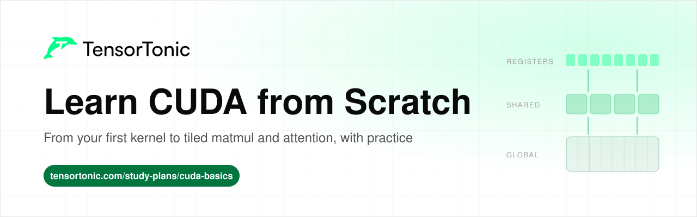
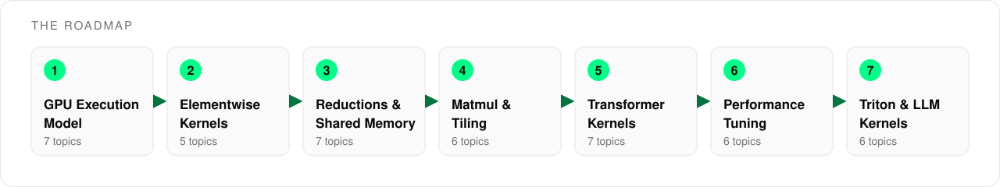

# Learn CUDA from Scratch

  

This is a roadmap for learning CUDA, in the order the ideas build on each other. It covers 44 topics across seven stages, from how a GPU runs threads to the softmax, normalization and attention kernels inside a transformer.

Every topic links to a short explanation and to practice problems where you write the kernel yourself and run it against tests on a real NVIDIA GPU in the browser. You do not need to own a GPU to follow any stage.

## Table of Contents

- [Who this is for](#who-this-is-for)
- [How to use this roadmap](#how-to-use-this-roadmap)
- [Stage 1: GPU Execution Model](#stage-1-gpu-execution-model)
- [Stage 2: Elementwise Kernels](#stage-2-elementwise-kernels)
- [Stage 3: Reductions and Shared Memory](#stage-3-reductions-and-shared-memory)
- [Stage 4: Matmul and Tiling](#stage-4-matmul-and-tiling)
- [Stage 5: Transformer Kernels](#stage-5-transformer-kernels)
- [Stage 6: Performance Tuning](#stage-6-performance-tuning)
- [Stage 7: Triton and LLM Kernels](#stage-7-triton-and-llm-kernels)
- [What's next](#whats-next)

## Who this is for

This roadmap is for anyone who wants to understand what happens underneath PyTorch when a model runs on a GPU.

- If you are a **student**, go through the stages in order and write at least one kernel per topic.
- If you are **preparing for interviews**, the reduction, tiling and performance stages cover most of the GPU questions that come up.
- If you already **work in ML**, use the tables as a checklist and start with the stage where your own kernels would slow down.

You need to be comfortable with C-style code, meaning pointers, arrays and loops, and with basic linear algebra. You do not need any GPU experience.

## How to use this roadmap

Each stage builds on the ones before it. Reductions need the thread model from the first stage, tiled matrix multiplication reuses shared memory from the reductions, and the transformer kernels combine all of it.

For each topic, read the explanation first, then write the kernel from the problem description and submit it. Get it correct before you try to make it fast. Topics without a practice link are still worth reading, because the later kernels depend on them.

## Stage 1: GPU Execution Model

A GPU runs thousands of simple threads at once instead of a few fast ones, and CUDA only makes sense once you see how that work is organised. This stage covers the hardware, the thread hierarchy and the index arithmetic that every kernel starts with.

| Topic | Read | Practice |
| --- | --- | --- |
| CPU vs GPU design | [How do you learn CUDA programming?](https://www.tensortonic.com/guides/how-to-learn-cuda) | |
| Streaming multiprocessors and warps | [Which GPU execution model questions come up first?](https://www.tensortonic.com/guides/cuda-interview-questions) | |
| Memory hierarchy | [Why does memory access matter more than arithmetic?](https://www.tensortonic.com/guides/how-to-learn-cuda) | |
| Host and device memory | [Do you need your own GPU to practise CUDA?](https://www.tensortonic.com/guides/cuda-practice-problems) | |
| Threads, blocks and grids | [In what order should you practise CUDA problems?](https://www.tensortonic.com/guides/cuda-practice-problems) | [Vector Addition as a CUDA Kernel](https://www.tensortonic.com/problems/vector-addition) |
| Global index and bounds checks | [CUDA Kernels study plan](https://www.tensortonic.com/study-plans/cuda-basics) | [Vector Subtraction as a CUDA Kernel](https://www.tensortonic.com/problems/vector-subtract) |
| Two-dimensional grids | [What is matrix multiplication?](https://www.tensortonic.com/ml-math/linear-algebra/matrix-multiplication) | [Matrix Addition as a CUDA Kernel](https://www.tensortonic.com/problems/matrix-addition), [Outer Product as a CUDA Kernel](https://www.tensortonic.com/problems/outer-product) |

## Stage 2: Elementwise Kernels

In an elementwise kernel each thread reads one value, applies a function and writes one result, with no cooperation between threads. These kernels teach the most important performance fact on a GPU, which is that most of them are limited by memory bandwidth rather than arithmetic.

| Topic | Read | Practice |
| --- | --- | --- |
| Activation kernels | [CUDA practice problems](https://www.tensortonic.com/guides/cuda-practice-problems) | [ReLU as a CUDA Kernel](https://www.tensortonic.com/problems/relu), [Leaky ReLU as a CUDA Kernel](https://www.tensortonic.com/problems/cuda-leaky-relu) |
| Memory-bound kernels | [Why does memory access matter more than arithmetic?](https://www.tensortonic.com/guides/how-to-learn-cuda) | [Hadamard Product as a CUDA Kernel](https://www.tensortonic.com/problems/hadamard-product) |
| Numerically stable activations | | [Sigmoid as a CUDA Kernel](https://www.tensortonic.com/problems/sigmoid), [Tanh as a CUDA Kernel](https://www.tensortonic.com/problems/tanh) |
| Transformer activations | | [Exact GELU as a CUDA Kernel](https://www.tensortonic.com/problems/cuda-gelu), [Swish (SiLU) as a CUDA Kernel](https://www.tensortonic.com/problems/swish) |
| Dropout masks | | [Dropout as a CUDA Kernel](https://www.tensortonic.com/problems/dropout) |

## Stage 3: Reductions and Shared Memory

A reduction turns many inputs into one output, such as a sum, a maximum or a dot product, so threads now have to cooperate. This stage introduces shared memory and block barriers, the two tools that almost every fast kernel relies on.

| Topic | Read | Practice |
| --- | --- | --- |
| Shared memory and tree reduction | [Which parallel patterns should you learn first?](https://www.tensortonic.com/guides/how-to-learn-cuda) | [Sum of Array as a CUDA Kernel](https://www.tensortonic.com/problems/sum-of-array) |
| Identity values for idle threads | | [Max of Array as a CUDA Kernel](https://www.tensortonic.com/problems/max-of-array), [Min of Array as a CUDA Kernel](https://www.tensortonic.com/problems/min-of-array) |
| Combining results across blocks | [Which CUDA kernels are you asked to write in an interview?](https://www.tensortonic.com/guides/cuda-interview-questions) | [CUDA Dot Product: Multi-Block Reduction](https://www.tensortonic.com/problems/cuda-dot-product) |
| Index reductions | | [Argmax as a CUDA Kernel](https://www.tensortonic.com/problems/argmax), [Argmin as a CUDA Kernel](https://www.tensortonic.com/problems/argmin) |
| Mean and variance | | [Mean and Variance as a CUDA Kernel](https://www.tensortonic.com/problems/mean-variance) |
| Vector norms | [What are dot products and norms?](https://www.tensortonic.com/ml-math/linear-algebra/dot-norm) | [L2 Normalization as a CUDA Kernel](https://www.tensortonic.com/problems/l2-normalize), [L1 Normalization as a CUDA Kernel](https://www.tensortonic.com/problems/l1-normalize) |
| Cosine similarity | [What are dot products and norms?](https://www.tensortonic.com/ml-math/linear-algebra/dot-norm) | [Cosine Similarity as a CUDA Kernel](https://www.tensortonic.com/problems/cuda-cosine-similarity) |

## Stage 4: Matmul and Tiling

Matrix multiplication is the kernel behind every neural network layer. The naive version is correct but rereads the same values from global memory again and again, and tiling fixes that by loading blocks of each matrix into shared memory once and reusing them.

| Topic | Read | Practice |
| --- | --- | --- |
| Naive matrix multiplication | [What is matrix multiplication?](https://www.tensortonic.com/ml-math/linear-algebra/matrix-multiplication) | [Matrix Multiplication as a CUDA Kernel](https://www.tensortonic.com/problems/matrix-multiplication) |
| Matrix-vector multiplication | | [Matrix-Vector Multiplication as a CUDA Kernel](https://www.tensortonic.com/problems/gemv) |
| Shared-memory tiling | [Which parallel patterns should you learn first?](https://www.tensortonic.com/guides/how-to-learn-cuda) | [Tiled Matrix Multiplication as a CUDA Kernel](https://www.tensortonic.com/problems/tiled-matmul) |
| Transpose through a shared tile | [What memory questions do CUDA interviews ask?](https://www.tensortonic.com/guides/cuda-interview-questions) | [Matrix Transpose as a CUDA Kernel](https://www.tensortonic.com/problems/cuda-matrix-transpose) |
| 1D and 2D convolution | | [1D Convolution as a CUDA Kernel](https://www.tensortonic.com/problems/conv-1d), [2D Convolution as a CUDA Kernel](https://www.tensortonic.com/problems/conv-2d) |
| 3D convolution and pooling | | [3D Convolution as a CUDA Kernel](https://www.tensortonic.com/problems/conv-3d), [Max Pool 2D as a CUDA Kernel](https://www.tensortonic.com/problems/max-pool-2d) |

## Stage 5: Transformer Kernels

The kernels inside a transformer combine row-wise reductions, numerically stable math and tiled matrix products. This stage ends with attention and the online softmax that lets FlashAttention keep the score matrix out of global memory.

| Topic | Read | Practice |
| --- | --- | --- |
| Stable softmax | [Which CUDA kernels are you asked to write in an interview?](https://www.tensortonic.com/guides/cuda-interview-questions) | [Softmax as a CUDA Kernel](https://www.tensortonic.com/problems/softmax) |
| Cross-entropy loss | [What is cross-entropy?](https://www.tensortonic.com/ml-math/information-theory/cross-entropy) | [Cross-Entropy Loss as a CUDA Kernel](https://www.tensortonic.com/problems/cross-entropy) |
| Layer normalization | [What is layer normalization?](https://www.tensortonic.com/research/transformer/transformers-layer-normalization) | [Layer Normalization as a CUDA Kernel](https://www.tensortonic.com/problems/layer-norm) |
| RMS normalization | | [RMS Normalization as a CUDA Kernel](https://www.tensortonic.com/problems/rms-norm) |
| Scaled dot-product attention | [Attention in LLMs](https://www.tensortonic.com/llm-internals/attention-mechanism) | [Scaled Dot-Product Attention in CUDA](https://www.tensortonic.com/problems/scaled-dot-product-attention) |
| Online softmax | [FlashAttention explained](https://www.tensortonic.com/llm-internals/flash-attention) | [Blockwise Online Softmax](https://www.tensortonic.com/problems/cs336-l05-blockwise-online-softmax) |
| FlashAttention | [Write FlashAttention step by step](https://www.tensortonic.com/projects/flash-attention-from-scratch) | [FlashAttention Forward Kernel in Triton](https://www.tensortonic.com/problems/triton-flash-attention-fwd) |

## Stage 6: Performance Tuning

A correct kernel is only the first step, and making it fast starts with measuring where the time goes. This stage covers how to time a kernel, the memory access patterns that slow it down, and the roofline model that tells you whether memory or arithmetic is the limit.

| Topic | Read | Practice |
| --- | --- | --- |
| Timing a kernel | [How do you benchmark a CUDA kernel?](https://www.tensortonic.com/guides/cuda-practice-problems) | [Measure Kernel Timeline Utilization](https://www.tensortonic.com/problems/cs336-l18-kernel-timeline-utilization) |
| Memory coalescing | [What memory questions do CUDA interviews ask?](https://www.tensortonic.com/guides/cuda-interview-questions) | [Global-Memory Coalescing Counter](https://www.tensortonic.com/problems/cs336-l05-global-memory-coalescing) |
| Shared-memory bank conflicts | [What memory questions do CUDA interviews ask?](https://www.tensortonic.com/guides/cuda-interview-questions) | [Shared-Memory Bank Conflict Analyzer](https://www.tensortonic.com/problems/cs336-l05-shared-memory-bank-conflicts) |
| Occupancy | [How do interviewers test kernel performance?](https://www.tensortonic.com/guides/cuda-interview-questions) | [GPU Occupancy Calculator](https://www.tensortonic.com/problems/cs336-l05-gpu-occupancy-calculator) |
| Warp divergence | [How does the GPU execution model work?](https://www.tensortonic.com/guides/how-to-learn-cuda) | |
| Roofline model | [How do you know if a kernel is fast?](https://www.tensortonic.com/guides/how-to-learn-cuda) | [Analyze Prefill and Decode with the Roofline Model](https://www.tensortonic.com/problems/inference-prefill-decode-roofline) |

## Stage 7: Triton and LLM Kernels

Once you can write CUDA, Triton lets you write the same kernels in Python at the level of blocks, with the compiler handling thread mapping and shared memory. This stage uses it for the fused and model-specific kernels found in LLM training and inference.

| Topic | Read | Practice |
| --- | --- | --- |
| Triton programming model | [Should you learn CUDA or Triton first?](https://www.tensortonic.com/guides/how-to-learn-cuda) | [Vector Addition in Triton](https://www.tensortonic.com/problems/triton-vector-addition) |
| Kernel fusion | [What are fused kernels, and why do ML engineers write them?](https://www.tensortonic.com/guides/how-to-learn-cuda) | [Fused Row-Wise Softmax in Triton](https://www.tensortonic.com/problems/triton-fused-softmax), [Fused Matmul + Bias + ReLU in Triton](https://www.tensortonic.com/problems/triton-fused-matmul-bias-relu) |
| Autotuning | [Triton Kernels study plan](https://www.tensortonic.com/study-plans/triton-basics) | [Autotuned Matrix Multiplication in Triton](https://www.tensortonic.com/problems/triton-matmul-autotune) |
| Rotary position embeddings | [RoPE explained](https://www.tensortonic.com/llm-internals/rope) | [Rotary Position Embedding in Triton](https://www.tensortonic.com/problems/triton-rope) |
| KV cache writes | [What is the KV cache?](https://www.tensortonic.com/llm-internals/kv-cache) | [KV Cache Append in Triton](https://www.tensortonic.com/problems/triton-kv-append) |
| Reduced precision and quantization | [FP16 vs BF16](https://www.tensortonic.com/llm-internals/mixed-precision), [LLM quantization explained](https://www.tensortonic.com/llm-internals/quantization) | [Symmetric INT8 Quantization](https://www.tensortonic.com/problems/inference-symmetric-int8-quantization) |

## What's next

Once these kernels feel familiar, the [CUDA Kernels study plan](https://www.tensortonic.com/study-plans/cuda-basics) and the [Triton Kernels study plan](https://www.tensortonic.com/study-plans/triton-basics) collect every kernel above in one place. The [FlashAttention project](https://www.tensortonic.com/projects/flash-attention-from-scratch) builds a full attention kernel step by step, and the [Inference Engineering study plan](https://www.tensortonic.com/study-plans/cracking-inference) shows where these kernels fit in a production LLM server.

## License

MIT
